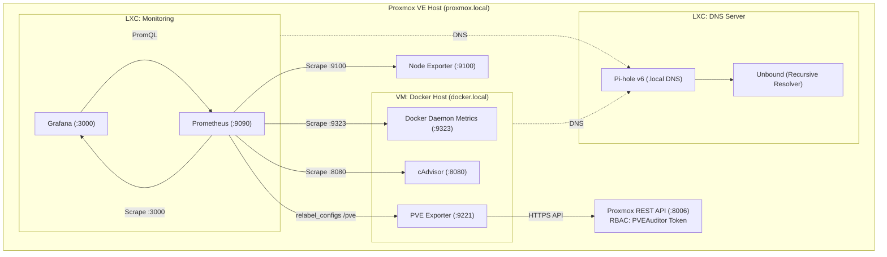

# Homelab Infrastructure & Observability

Configuration files and dashboards for my personal Proxmox-based homelab. This repository contains the monitoring stack (Prometheus, Grafana, exporters) and DNS setup (Pi-hole + Unbound).

## Architecture



## Stack

| Component  | Tool                                  | Notes                                                       |
| :--------- | :------------------------------------ | :---------------------------------------------------------- |
| Hypervisor | Proxmox VE                            | Hosts VMs and LXC containers                                |
| DNS        | Pi-hole v6 + Unbound                  | Local `.local` domain resolution and recursive DNS          |
| Containers | Docker & Compose                      | Runs monitoring exporters on the Docker VM                  |
| Metrics    | Prometheus                            | Scrapes host, hypervisor, and container metrics             |
| Exporters  | Node Exporter, cAdvisor, PVE Exporter | Hardware metrics, cgroups v2 stats, and Proxmox API metrics |
| Dashboards | Grafana                               | Provisioned JSON dashboards                                 |

## Design Notes

- **Service Discovery via Local DNS:** No hardcoded IP addresses in configs. Prometheus targets use internal DNS records (`proxmox.local`, `docker.local`, `grafana.local`) resolved by Pi-hole.
- **Least Privilege API Access:** The Proxmox exporter authenticates using an isolated token (`root@pam!prometheus`) restricted to the read-only `PVEAuditor` role.
- **Secrets Management:** Proxmox API credentials are kept out of Git and mounted into the `pve-exporter` container at runtime from `/etc/pve.yml` (`:ro`).
- **Multi-Target Scraping:** Prometheus uses `relabel_configs` (`__param_target` -> `instance`) to query the Proxmox VE exporter.

## Repository Structure

```text
.
├── docker/
│   └── docker-compose.yml           # cAdvisor and PVE Exporter definitions
├── prometheus/
│   └── prometheus.yml               # Scrape configs and relabeling rules
├── grafana/
│   ├── docker-daemon-dashboard.json # Docker engine metrics (:9323)
│   └── proxmox-pve-dashboard.json   # Proxmox cluster & LXC metrics
└── README.md
```

## Roadmap

- [x] Local DNS (Pi-hole + Unbound) and core monitoring (Prometheus + Grafana)
- [ ] Ansible playbooks for host configuration and automated deployments
- [ ] Terraform provisioning for Proxmox VMs and LXC containers
- [ ] GitHub Actions CI for linting configs (`promtool`, YAML, Terraform)
- [ ] K3s cluster deploym
