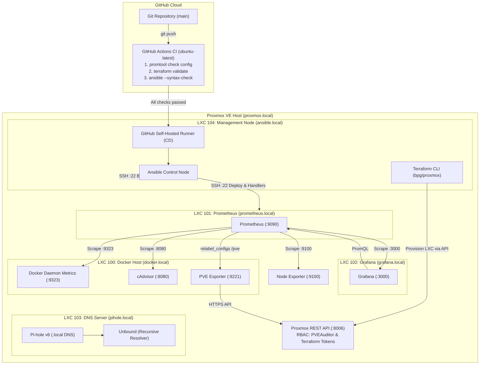

# Homelab Infrastructure, IaC & CI/CD Pipeline

Configuration files, Infrastructure as Code (Terraform, Ansible), CI/CD workflows, and observability dashboards for my personal Proxmox-based homelab.

## Architecture



## Tech Stack

| Layer                  | Technology                            | Role in Project                                                       |
| :--------------------- | :------------------------------------ | :-------------------------------------------------------------------- |
| **Hypervisor**         | Proxmox VE                            | Type-1 hypervisor hosting isolated Debian LXC containers and VMs      |
| **Provisioning (IaC)** | Terraform (`bpg/proxmox`)             | Declarative LXC container provisioning via the Proxmox API            |
| **Config Management**  | Ansible                               | Agentless OS configuration, package management, and service deploys   |
| **CI/CD**              | GitHub Actions (Cloud + Self-Hosted)  | Cloud linting/validation (CI) and automated on-premise deployment (CD)|
| **DNS**                | Pi-hole v6 + Unbound                  | Local `.local` domain resolution and independent recursive DNS        |
| **Containers**         | Docker, Docker Compose & Portainer    | Runs containerized monitoring exporters (`cAdvisor`, `pve-exporter`)  |
| **Metrics (TSDB)**     | Prometheus                            | Scrapes hardware, hypervisor, and container metrics                   |
| **Exporters**          | Node Exporter, cAdvisor, PVE Exporter | Extracts host metrics, cgroups v2 stats, and Proxmox API telemetry    |
| **Visualization**      | Grafana                               | Dashboards as Code (`.json`) for real-time infrastructure monitoring  |

## Engineering & Security Practices

- **Hybrid Cloud / On-Premise CI/CD Pipeline:** Every `git push` triggers 3 parallel cloud jobs in GitHub Actions (`promtool`, `terraform validate`, `ansible-playbook --syntax-check`). Once all checks pass, an internal **self-hosted runner** on the management LXC executes Ansible playbooks behind NAT without exposing SSH ports to the internet.
- **Declarative Provisioning with Terraform:** Containers are provisioned via the `bpg/proxmox` provider with `ed25519` SSH public keys automatically injected at creation time, enabling immediate passwordless Ansible access.
- **Idempotent Ansible Playbooks & Safe Rollouts:** Prometheus configuration updates are validated on the target node (`validate: promtool check config %s`) prior to replacement, and systemd restarts are triggered strictly via Ansible `handlers` when a checksum change is detected.
- **Service Discovery via Local DNS:** No hardcoded IP addresses in monitoring configs. Targets use internal DNS records (`proxmox.local`, `docker.local`, `grafana.local`, `prometheus.local`) resolved by Pi-hole.
- **Least Privilege & Secret Separation:** The Proxmox monitoring exporter uses a read-only token (`PVEAuditor` role with privilege separation) mounted at runtime from `/etc/pve.yml` (`:ro`), while Terraform credentials and `.tfstate` files are isolated via `.tfvars` and `.gitignore`.

## Repository Structure

```text
.
├── .github/
│   └── workflows/
│       └── ci.yml                   # CI validation (Cloud) + CD deployment (Self-Hosted Runner)
├── ansible/
│   ├── inventory.ini                # Grouped homelab host inventory
│   ├── base-setup.yml               # DNS configuration and base package provisioning
│   └── deploy-prometheus.yml        # Validated Prometheus config rollout with handlers
├── terraform/
│   ├── main.tf                      # Proxmox LXC resource definitions
│   ├── variables.tf                 # Input variable declarations (sensitive API token)
│   └── .terraform.lock.hcl          # Provider dependency lock file
├── docker/
│   └── docker-compose.yml           # cAdvisor (v0.50.0) and PVE Exporter definitions
├── prometheus/
│   └── prometheus.yml               # Scrape configs and multi-target relabeling rules
├── grafana/
│   ├── docker-daemon-dashboard.json # Docker engine metrics (:9323)
│   └── proxmox-pve-dashboard.json   # Proxmox VE node & LXC telemetry
└── readme.md
```

## Roadmap

- [x] Local DNS (Pi-hole + Unbound) and full observability stack (Prometheus + Grafana + Exporters)
- [x] Ansible playbooks for multi-node configuration and validated Prometheus deployments
- [x] Terraform provisioning for Proxmox LXC containers with automated SSH key injection
- [x] GitHub Actions CI/CD pipeline (`promtool`, Terraform, Ansible validation + Self-Hosted Runner CD)
- [ ] K3s (Lightweight Kubernetes) cluster deployment and workload orchestration
